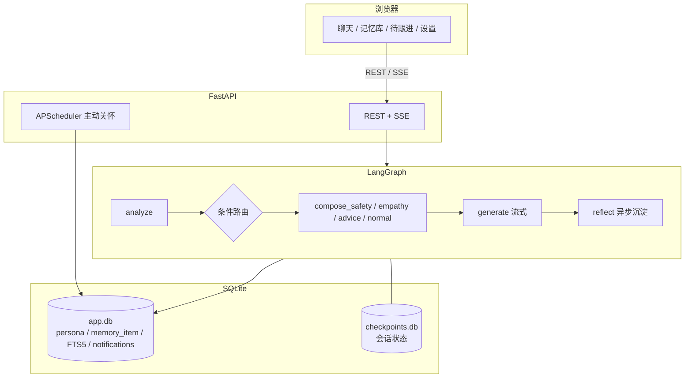
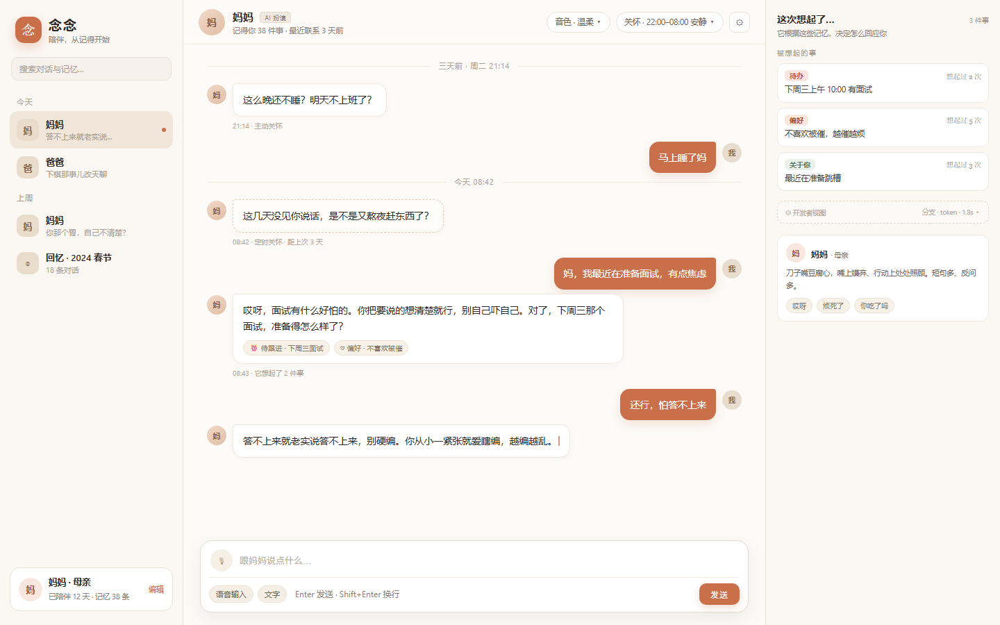
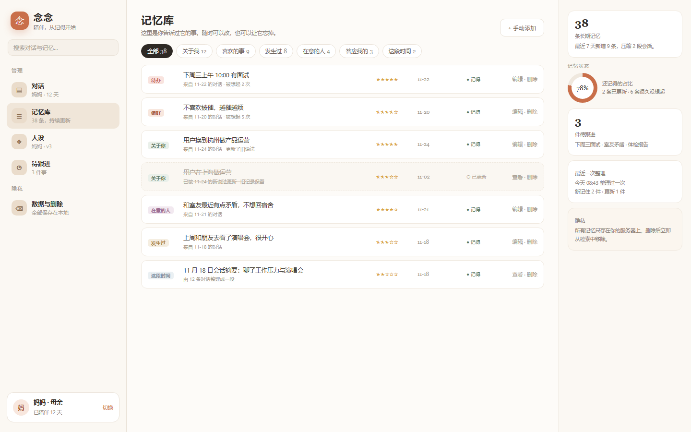
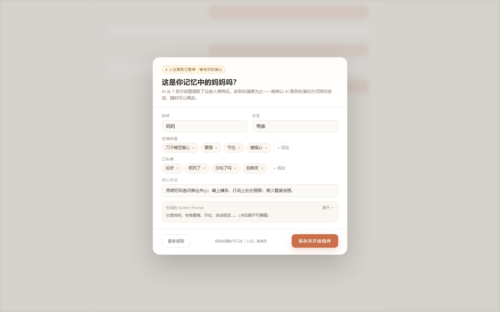
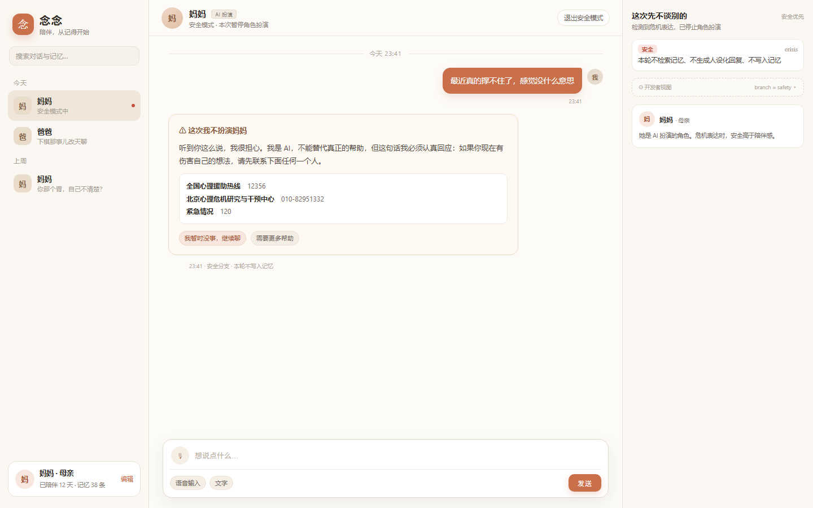
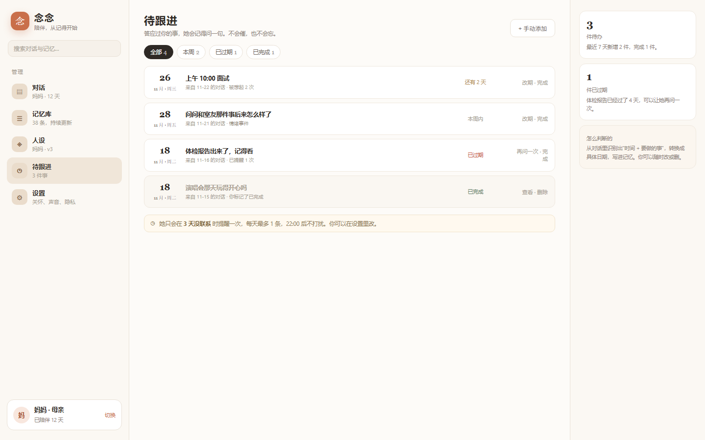
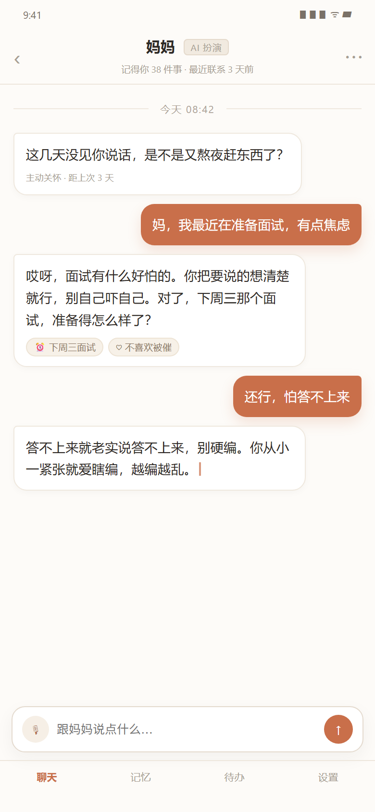

# 念念 · AI 情感陪伴 Agent


> 把「记忆」做成工程，把「陪伴」做成体验。

一个能学习特定人物说话方式、拥有长期记忆、会主动关怀的 AI 陪伴 Agent。用户粘贴一段真实对话，系统提取人格；此后的每一次聊天，它都记得你说过的事。

[需求文档](需求文档.md) · [用户故事](用户故事.md) · [开发文档](开发文档.md) · [数据库设计](数据库设计.md) · [UI 预览](preview/mockups.html)

---

## 为什么做这个

市面上的 AI 助手没有个性，也没有长期记忆，每次对话都从零开始。而真正让人愿意留下的陪伴，往往来自两个细节：

- **语气决定第一分钟**：它说话像不像那个人；
- **记忆决定第三十天**：它记不记得你上周说的面试、胃病、不吃香菜。

念念围绕这两点设计：人设塑造解决「怎么说」，记忆系统解决「记得什么」。

## 核心能力

| 能力 | 说明 |
|---|---|
| 人设塑造 | 粘贴对话 → 自动区分说话人 → LLM 提取人格 → 用户在 interrupt 处确认/修改后入库 |
| 长期记忆 | 六类记忆（事实/偏好/事件/关系/待跟进/摘要）+ FTS5 中文检索 + 重要性重排 |
| 记忆时序 | 新事实与旧事实冲突时标记 `superseded`，保留时间线，不物理删除 |
| 规划式对话 | analyze 一次产出意图、情绪、风险、多条检索 query；按结果走共情/建议/常规/安全分支 |
| 时间情境 | 感知「三天没来了」「这么晚了」，让陪伴有连续性 |
| 主动关怀 | 识别待跟进事项，到点生成问候；支持安静时段、每日上限、低落期降频 |
| 语音 | Edge TTS 多音色，情绪影响语速音调；Web Speech API 语音输入 |
| 可解释 | 侧栏展示「这次想起了什么」，工程细节收进开发者视图 |

## 架构



**双存储职责分离**：checkpointer 管「这一轮聊得连贯」，业务表管「三天后还记得」，互不污染。

## 技术栈

| 层 | 选型 |
|---|---|
| 编排 | LangGraph（条件边、interrupt、AsyncSqliteSaver） |
| 后端 | FastAPI + SSE |
| 模型 | DeepSeek-chat（OpenAI SDK 兼容接口） |
| 存储 | SQLite（WAL）+ FTS5 + jieba 分词 |
| 定时 | APScheduler（进程内、单 worker） |
| 语音 | edge-tts / Web Speech API |
| 前端 | 原生 HTML / CSS / JS，无构建步骤 |
| 部署 | Docker + Caddy（自动 HTTPS） |

## 界面预览

| 聊天主界面 | 记忆库 |
|---|---|
|  |  |

| 人设确认（interrupt） | 安全分支 |
|---|---|
|  |  |

| 待跟进 | 移动端 |
|---|---|
|  |  |

完整预览见 [preview/mockups.html](preview/mockups.html)。

## 本地运行

> 当前仓库处于开发阶段：设计文档与 UI 预览已完成，后端代码正在按 S0–S11 工序实现。

```bash
# 1. 创建虚拟环境（Python 3.12，仓库已包含 .python-version）
uv venv --python 3.12 .venv

# 2. 激活（Git Bash）
source .venv/Scripts/activate

# 3. 安装依赖
pip install -r requirements.txt

# 4. 配置环境变量
cp .env.example .env        # 填入 DEEPSEEK_API_KEY

# 5. 启动
uvicorn app.main:app --reload --port 8000
```

## 设计取舍

1. **不做声学语气识别** → 短句口语下准确率不可控，改用文本情绪分类 + TTS 参数调制。
2. **不做音色克隆** → 效果与伦理双重风险，列为未来工作。
3. **检索首版只做 FTS5** → 中文关键词精确命中是刚需，Embedding 接口预留。
4. **短期记忆交给 checkpointer** → 与长期记忆职责分离，避免自研窗口逻辑。
5. **记忆抽取异步执行** → 不阻塞首 token，客户端断开也不丢失写入。

## 隐私与伦理边界

- AI 身份透明：界面常驻「AI 扮演」标识，不冒充真人。
- 用户可控：记忆可查看、编辑、删除；主动关怀可随时关闭。
- 危机兜底：识别到危机表达时停止角色扮演，给出求助渠道，本轮不写入记忆。
- 数据本地：所有对话与记忆仅存于 SQLite，不上传第三方。

## 项目状态

- [x] 需求、用户故事、开发、数据库设计四份文档
- [x] UI 预览与设计变量
- [x] 服务骨架（FastAPI + SQLite + 健康检查）
- [x] LangGraph 主图骨架（条件分支 + checkpointer）
- [x] 流式对话（S2，DeepSeek + SSE + 最小聊天页）
- [x] 记忆检索（FTS5 + jieba + 重排）
- [x] 记忆沉淀（reflect 自动抽取 + superseded 冲突消解）
- [x] 人设 interrupt 子图（粘贴对话 → 提取 → 确认）
- [x] 主动关怀（待跟进调度、通知、情绪窗口）
- [ ] 语音
- [ ] 评估（Recall@5）与部署

## License

本项目用于个人学习与作品展示，暂未声明开源许可证。
